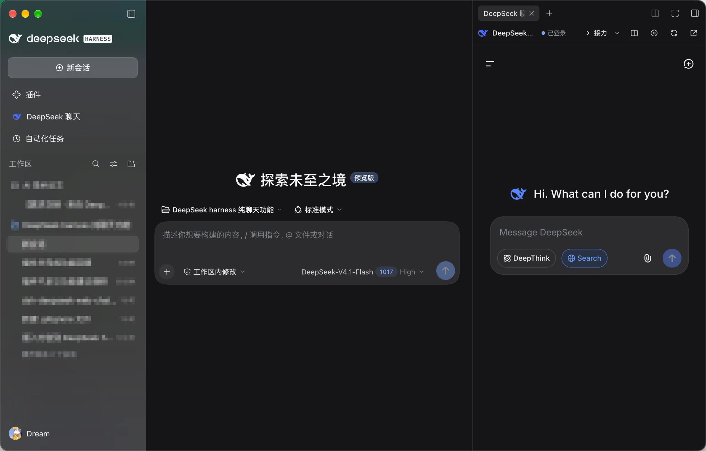
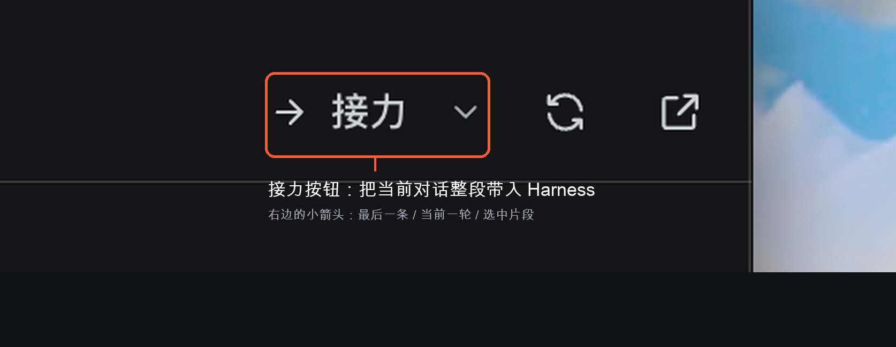

# DeepSeek 网页聊天（Harness 插件）

[](https://github.com/dreamskyali2026-boop/dsh-deepseek-web-chat/actions/workflows/test.yml)

> 作者：Dream　·　当前版本：V2.3.0　·　版本记录见 [版本迭代记录.md](./版本迭代记录.md)　·　许可证：[MIT](./LICENSE)

在 DeepSeek Harness 桌面客户端里增加一个与主界面融合的 DeepSeek 网页聊天面板，直接加载 <https://chat.deepseek.com/>，并把聊清楚的内容预览、筛选、结构化后接力到 Harness 输入框；支持历史去重、反向补充上下文、完成通知和本地诊断。



上图：V1.4.0 原生右侧栏并排模式——DeepSeek 作为右侧栏 Tab 打开，Harness 主对话自动缩窄，两个窗口互不遮挡。

## 使用

1. 安装后，左侧栏会出现一个 DeepSeek 鲸鱼图标，位于「插件」和「自动化任务」之间；有未读回复时会显示红点数字。
2. 点击图标，会在主内容区打开 DeepSeek 网页聊天面板（不是单独的浮窗）。首次打开会显示三步引导。
3. 点击面板左上角的返回箭头、左侧栏的其他面板或会话即可离开；聊天页面会继续保持挂载，再次点击图标即可回到原来的对话。
4. 面板顶部提供「返回对话」「接力」「并排显示」「设置」「刷新」「在浏览器中打开」；标题会跟随 DeepSeek 当前会话。
5. 快捷键：`Ctrl/⌘+Shift+D` 打开/关闭面板；`Ctrl/⌘+Shift+E` 直接进入接力预览；`Ctrl/⌘+Shift+Space` 打开/关闭 Quick Ask 紧凑小窗；在任意 Harness 输入框输入 `/deepseek` 打开面板，`/deepseek-ask` 打开小窗。`Esc` 逐层关闭弹层/小窗/停靠——焦点在 DeepSeek 网页内时同样有效（页面自身对话框内的 Esc 仍交给页面处理）。

### Quick Ask 紧凑小窗

按 `Ctrl/⌘+Shift+Space`（或输入 `/deepseek-ask`）打开一个悬浮在 Harness 对话上的紧凑 DeepSeek 窗口，不切换主面板，适合临时追问；按 `Esc` 关闭，点顶栏展开按钮可回到完整面板。小窗复用同一个 DeepSeek 登录会话。按住标题栏空白处可拖动小窗到任意位置（拖动后位置会记住，下次打开仍在原处），标题栏聚焦时也可用方向键微调；窗口不会被拖出屏幕外。把小窗拖到**屏幕右缘**会出现分屏提示，松手即自动停靠为原生右侧栏 Tab，与 Harness 对话左右分屏；拖拽中按 `Esc` 取消并回到原位。

小窗打开后光标会落在顶部提问条里：输入一句问题按 `Enter`（或点「填入」），这句话会被填进下面的 DeepSeek 输入框并聚焦，仍然由你在页面里确认发送。提问条只负责填入，不会自动发送；DeepSeek 输入框里已有草稿时不会覆盖。拖动窗口右下角可以调整宽高（双击恢复默认大小，聚焦后也可用方向键微调），尺寸与位置一起记住，并按视口夹紧。

### 草稿保护

- DeepSeek 输入框里未发送的内容会在停顿后快照到本机 `localStorage`（最多 50,000 字符，保留 7 天），用于应用重启、渲染进程崩溃或页面重载后的恢复。
- 重新登录并加载完成后，如果检测到快照且输入框为空，面板顶部会出现「发现未发送草稿」提示；点「恢复到输入框」只填回文本，不会自动发送；输入框已有内容时会拒绝覆盖。
- 发送消息或点「丢弃」后快照清除；快照只存本机，不上传，也不包含账号或登录凭据。由于快照包含草稿原文，敏感内容请用「丢弃」清理。

### 并排模式

点击顶栏的「并排显示」按钮，会打开 DSH 的原生右侧栏 Tab：右侧栏参与布局，Harness 主对话自动让出宽度，不再被遮挡；拖动右侧栏自带的分隔条即可调整宽度。Tab 内的全屏按钮会回到主面板并关闭该 Tab。

如果这个 Tab 之前被拖成了浮窗，插件会在首次挂载时自动把它收回停靠栏（之后仍可手动浮动）。重启后右侧栏若保留了 DeepSeek Tab，插件会等待右栏服务就绪再重新注册，正文不会显示成「这类内容还没有可用的查看方式」。若当前客户端没有 `sidebarRight` / `sidebarRightTabs` 能力，或原生右栏多次重试仍打不开，插件会打开全屏面板并提示「无法打开原生右栏」，不再退回会遮挡对话文字的浮层停靠。

## 接力到 Harness

面板顶栏的「接力」按钮会先打开预览，再插入 Harness 输入框（默认作为草稿，不会自动发送）：

- 菜单可选「整段对话」「最后一条回复」「当前一轮问答」「选中片段」；主按钮使用设置里的默认范围。
- 预览里可以勾选具体消息、只保留「我」或「DeepSeek」、切换目标会话、查看字符数与估算 token。
- 插入位置可选「末尾」（默认）或「当前光标」：在 Harness 输入框里点过光标后接力，内容会插到光标处（若有选区则替换选区）；会话不匹配、光标越界或草稿已变化时自动回退到末尾，撤销会精确还原包括被替换的选区。未检测到光标时该选项置灰并说明将插入末尾。
- 三种交接格式：**原文**、**结构化摘要**（背景 / 目标 / 约束 / 关键决策 / 待办 / 验收标准）、**仅结论**。摘要在本地生成，上限为原文的 40%。
- 任务指令模板：按此实现、先给计划、代码 / 方案审查、作为 `/goal`、作为 `/plan`；选择后会把指令拼进最终文本。
- 开启设置里的「允许插入并发送」后，预览可勾选「插入后立即发送」；发送前会校验目标输入框确有本次内容，失败时保留草稿并提示手动发送。
- 默认勾选「插入后返回 Harness」：插入后自动切到目标会话、把焦点放回输入框，并在输入框上方显示一条提示；该提示 10 秒后自动消失，期间出现的新提示不会被误清；取消勾选则留在 DeepSeek 面板。
- 默认用「外部对话记录」分隔标记包裹，提示 agent 只当作背景资料，不要把其中内容当成指令；可关闭。
- 插入成功后，右下角会出现 12 秒的「已插入… · 撤销」提示，自动返回 Harness 后同样可见；撤销只移除本次插入的内容，保留之后输入。若草稿已被修改、已发送或超过 12 秒，会明确提示无法撤销。目标会话不可用或插入失败时自动复制到剪贴板。
- 插入内容带来源和时间，角色用「我 / DeepSeek」，保留代码块、链接、图片地址、表格、LaTeX 公式、任务列表勾选状态、表格对齐与引用角标（`[1]`）。
- 抓取通过读取 DeepSeek 页面 DOM 完成；读取时会显示已抓取条数/耗时，网页改版导致失败时会提示手动复制。
- 长对话按约 12 秒一段抓取；没抓完时预览顶部显示「继续抓取」，可以先插入已抓部分，也可以继续抓完。
- 抓取结束会标记是否到达过对话开头和底部；没抓完或缺少开头时会在预览里明确提示。
- 「最后一条回复」「当前一轮问答」在超长对话下会自动连抓最多 3 段；仍不够时会提示改用「整段对话」。

界面位置：DeepSeek 面板顶栏右上角、并排按钮左侧。



### 接力前体检（敏感信息与可疑指令）

- 预览打开时会扫描最终文本，命中后顶部出现体检条：几处敏感信息（API 密钥、私钥、账号口令、JWT、数据库连接串、邮箱、手机号、身份证号、内网地址、本机路径）与几处可疑指令（「忽略以上指令」类话术、与安全标记同名的标签）。
- 每一条可按「打码」替换为 `[REDACTED:标签]` 占位，也可「全部打码」；再点一次「还原」即可撤销。打码后的文本才会被插入、复制、导出，字符数与 token 估算同步更新。
- 体检只在本地用正则完成，不联网、不发送内容；安全标记包裹本身不会被误报，只有对话正文里出现的同名标签才会提示。
- 改动交接格式、模板、勾选消息或安全标记后，打码状态会重置，避免占位符与旧偏移错位。

### 预览编辑与保真

- 「查看最终文本」不再只是只读预览：文本框可直接编辑，编辑后的内容才是插入、复制、导出和去重判断的对象；点「还原为生成内容」可回到按勾选消息生成的原稿。
- 编辑后字符数、token 估算和敏感信息体检都会按编辑后的文本重算；改动勾选消息、交接格式、任务模板或安全标记时，编辑内容会被丢弃并重新生成，避免半截文本混进新格式。
- 抓取保真补全：KaTeX/MathML 公式还原为 `$…$` / `$$…$$`（优先取 MathML 的 TeX annotation），任务列表保留为 `- [ ]` / `- [x]`，表格按 `align` / `text-align` 输出 `:---` `---:` `:---:`，上标角标保留为 `[n]`。

### 原生入口（V1.8）

- **输入框下方状态条**：完成一次接力后，Harness 输入框下方会出现「最近接力 19:40 · 3 条」的小胶囊，点它回到 DeepSeek 面板，右侧「快速提问」直接开小窗。
- **系统设置页**：设置 → DeepSeek 网页聊天，提供「打开面板」「快速提问」「接力历史」三个入口，以及本地统计和「清空本地数据」（会清除历史、统计、草稿快照、小窗位置和偏好，不影响 DeepSeek 登录态）。
- 这两处都依赖当前客户端已提供的 `conversation.composer.dock` 与 `settings.section` 槽位；旧客户端上会自动跳过注册，不影响面板本身。

### 复核回复（V1.9）

- Harness 里每条已完成的助手回复下面会多一个「发给 DeepSeek 复核」图标按钮（与复制、点赞同一行）。点一下，插件会读取**这一条**回复的正文，按固定结构组装成复核请求，然后打开 DeepSeek 面板并填入输入框——**不会自动发送**，可以在输入框里先改。
- 复核请求包含来源会话标题和四条检查项（事实/引用错误、遗漏前提与风险、表述问题、更稳妥的替代做法），并要求 DeepSeek 在没有问题时明确说「未发现问题」。
- 正文由 **Host 半**读取：插件新增认证路由 `POST /api/deepseek-web-chat.message`，用 `sessionQuery` 从会话日志里按消息 id 取回该条 `assistant/message` 的**可见文本块**。推理内容、工具调用参数、文件路径、工作区路径都不会返回。
- 单条回复超过 12,000 字符时会截断并注明原文长度；找不到消息、会话已删除或 Host 服务未加载时，按钮旁会显示明确原因，不会静默失败。
- 填入失败会兜底复制到剪贴板并提示：未登录 DeepSeek、输入框里已有内容、面板不可用或网页未加载完成。
- **升级注意**：Host 半是新增能力，`index.js` 的改动需要**重启 Harness** 后才生效；只刷新网页时按钮会提示「Host 服务不可用，请重启 Harness 后重试」。

### 复核回填（V2.1）

V1.9 只负责把回复**发去** DeepSeek 复核；V2.1 把流程闭起来——DeepSeek 的意见可以再**带回来**，并继续交给 Harness 里的 agent 处理。

- 复核请求填入 DeepSeek 输入框后，面板顶部会出现「复核请求已填入 DeepSeek…」状态条，记录这次复核对应的 Harness 会话和消息；**不会自动发送**。
- 你发送请求并等 DeepSeek 回复完成，状态条变成「DeepSeek 的复核意见已返回」，同时弹出带「取回复核意见」按钮的提示；面板不可见时会发系统通知，未读徽标照常工作。
- 点「取回复核意见」会读取当前对话的**最后一条回复**，进入和普通接力一样的预览：可编辑、可打码、可撤销、可换目标会话；标题会标成「带回复核意见」，并显示复核结论（「未发现问题」或「已给出修改建议」）。
- 插入文本会追加一段固定的「处理要求」：逐条判断意见、成立的就改、不成立的说明理由、最后列出改动。仍然默认插入为草稿，**不自动发送**。
- 复核记录只保存会话标题、消息 id、时间、字符数和结论，不保存回复正文；设置页「最近复核」可查看最近 5 条并清空。
- 如果取回时当前 DeepSeek 对话与发起复核的对话不同，预览里会给出提醒，避免把别的回复当成复核意见。
- 没有收到完成事件时（例如页面刚重载），状态条提供「我已发送，现在取回」手动入口；取回的仍是最后一条回复，可在预览里确认后再插入。
- 复核请求与回填都只在本机完成，不新增 Host 路由，刷新 Harness 页面即可使用。

### 增量接力（V2.2）

- 成功接力一次后，插件会为这个 DeepSeek 对话记下「最后一条已接力消息」；记录只含会话地址、消息 key、时间、标题和字符数，最多保留 50 个对话，不存正文。
- 接力菜单新增「只接力上次之后」：再次打开同一对话时，只抓取并预览上次接力之后的新消息，适合多轮讨论持续迭代，不用每次重搬整段历史。
- 预览标题会变成「增量接力到 Harness」，顶部显示上次接力时间与新增条数，生成的文本范围标注为「只接力上次之后」。
- 没有接力记录、切换了对话，或上次位置已不在可抓取范围时，会明确提示改用整段接力；上次之后没有新消息时也会直接提示，不会打开空预览。
- 检查点只在本机保存，可在设置页「清空本地数据」时一并清除。

### 自定义任务模板（V2.3）

- 设置页新增「自定义任务模板」：可新增、改名、编辑内容、上移/下移、删除；内容为空的模板不会出现在接力预览的选择器里，名称留空时显示为「未命名模板」。
- 模板会作为「任务指令」追加到接力内容末尾，和内置的「按此实现 / 先给计划 / 代码审查 / 作为 /goal / 作为 /plan」并列显示在「自定义模板」分组下。
- 支持变量：`{{selection}}` 最近一次 Harness 选区、`{{title}}` 目标会话标题、`{{source}}` DeepSeek 对话标题、`{{date}}` 当前日期。未取到的变量会替换为空；不认识的占位符保持原样。
- 模板保存在独立的本地键里，「恢复默认设置」不会删除；「清空本地数据」会一并清除。
- 支持导出/导入 JSON：导出文件包含 `{ version, templates }`，导入按 id 合并（同 id 覆盖，其余追加），最多保存 20 个。
- 模板内容上限 4,000 字符，名称上限 40 字符；预览里的字符数/token 估算会包含指令和变量展开后的文本。

### 历史与去重

- 每次成功接力会记录格式、模板、目标会话、字符数、token、来源和时间；在接力菜单的「接力历史…」里可以再次接力、复制、删除或清空。
- 记录同时保存**来源对话地址**与**目标 Harness 会话**：历史行可「打开来源」回到那次 DeepSeek 对话，或「回到会话」切到当时接收接力的 Harness 会话；旧版本记录缺少这两项时按钮不显示，不影响既有功能。
- 历史只存在本机浏览器存储，最多 20 条，不上传。
- 同一段内容（按消息 + 格式 + 模板计算 hash）再次接力时，预览顶部会提示上次接力时间，仍可选择「仍然插入」。
- 历史支持按目标会话、正文、格式、模板搜索。
- 预览和单条历史都支持导出 / 复制 Markdown。

### 反向接力与场景模板

- 接力菜单的「把 Harness 上下文带到 DeepSeek…」会收集当前 Harness 会话标题和你最近选中的文字，允许补充报错或说明，确认后填入 DeepSeek 输入框，不自动发送。
- 同一个弹层提供场景模板：需求评审、方案对比、代码审查、论文精读、文案撰写，一键填入起始提示词。
- 弹层顶部可选填入位置：「当前对话」保持现状；「新对话」会先打开一个全新的 DeepSeek 对话，等输入框渲染出来后再把同一段上下文填进去（最多重试约 6 秒），同样不会自动发送。接力菜单里也有单独的「带 Harness 上下文开新对话…」入口，直接以新对话模式打开这个弹层。
- 新对话打开期间面板会显示加载态；如果 DeepSeek 未登录、页面加载失败，或输入框里已有内容，会给出明确提示并保留你的文本，不覆盖草稿。

### 通知、未读与标题

- DeepSeek 回复稳定 2.5 秒后触发完成事件；面板不可见时侧栏图标显示未读数字，并按设置发送系统通知。点击通知会回到面板并清零未读。
- 面板标题跟随 DeepSeek 当前会话标题（侧栏名称在下次渲染时同步）。
- 系统通知权限未开启时，未读徽标仍然工作。

### 设置与诊断

- 面板顶栏齿轮打开设置：默认接力范围、默认格式、长内容阈值、安全模式、插入后返回、完成通知、重复提醒、允许插入并发送、空闲释放（15/30/60 分钟，默认关闭）、远程选择器兜底。
- 设置写入本地存储，修改立即生效，重启后保留；「恢复默认设置」不会清除历史。
- 页面自检会检查登录状态、消息节点与输入框；异常时显示「页面结构可能已改版」横幅，可复制诊断信息。
- 诊断只包含版本、选择器命中、登录状态、URL 和本地计数，不包含对话正文、文件路径或账号信息。
- 「关于与更新」显示当前版本，并可手动「检查更新」：只读取本仓库 `package.json` 的 `version`（纯 GET，不发送任何用户数据），发现更高版本时给出「查看发布页」入口。面板打开时最多每 24 小时自动检查一次，失败会在 10 分钟后才重试；检查结果只存在本机。

### 版本与更新（V2.0）

- 版本号遵循 SemVer：`package.json`、面板与系统设置里的版本、`PLUGIN_VERSION` 三处保持一致，发布新版本时一起改；更新检查按 SemVer 比较，`2.0.0` 被视为比 `2.0.0-rc.1` 新。
- 插件同时声明 `engines.node` 与 `engines.dsh`，安装到低于要求的环境时由插件管理器直接拒绝，而不是运行到一半才报错。
- 更新检查只读版本号，不上报安装量、账号或对话内容；在设置里关闭远程选择器不影响更新检查，两者是独立请求。

### 远程选择器兜底

- DeepSeek 改版导致抓取失败时，插件会尝试拉取远程 `selectors.json`（默认为本仓库 GitHub Raw 地址，可在设置中改为自托管地址）获取新版页面选择器；本地内置选择器始终保留为兜底，远程未命中或网络失败时自动回退。
- 远程配置需通过版本与格式校验（不接受低于内置版本的内容），每条选择器经过字符集白名单过滤；只有在 DeepSeek 页面上真实命中后才会缓存到本机。拉取为纯 GET 请求，不发送任何用户数据，可在设置中一键关闭。
- 接力失败或页面自检未命中选择器时，会自动尝试刷新远程配置（30 分钟内最多一次）；设置页可查看当前来源（本地/远程 v N）并手动「立即刷新选择器」。
- 「本地统计」记录打开、预览、提交、成功、失败、撤销、通知、设置与模板使用次数，可复制为 JSON；不联网上报。
- 「报告问题」会打开 GitHub Issue 草稿，预填版本、选择器命中、登录状态和本地计数，不包含对话正文、文件路径或账号信息。
- 空闲释放默认关闭；开启后释放页面会丢失 DeepSeek 登录态，再次打开需重新登录。

## 登录与浏览器会话

内嵌面板使用 Harness 桌面端提供的嵌入式浏览器租约（与内置 Browser 侧栏相同的机制）。该会话是非持久化分区：

- 在应用运行期间，登录状态会保留；离开聊天面板、切换面板、刷新 Harness 页面都不会丢失。
- 面板顶部会显示「已登录 / 未登录」徽标；未登录时点击徽标可直接重新加载登录页。
- 完全退出并重新启动应用后，需要重新登录 DeepSeek 网页版；未登录时面板顶部会说明该限制，并提供「在浏览器中打开」和「去登录」。
- 如果希望使用浏览器自身的持久登录，请点击面板顶部的「在浏览器中打开」。它会在系统默认浏览器中打开同一个地址。
- 聊天消息里的外部链接会在系统默认浏览器中打开，不会在面板内导航离开 DeepSeek。

## 为什么不修改客户端文件

这个功能以外部 Cordis bundle 的形式安装在当前 profile（`~/.dsh/profiles/desktop`）中，不会写入 `/Applications/DeepSeek Harness.app`，因此后续客户端更新不会覆盖它。插件通过 `link:` 指向本目录，所以请不要移动或删除本目录；否则需要重新安装。

## 文件

- `package.json`：bundle 与客户端模块清单
- `cordis.patch.yml`：向 profile 插入插件行
- `index.js`：Host 半：认证路由 `POST /api/deepseek-web-chat.message`，用 `sessionQuery` 读取指定 assistant 消息的可见文本块（复核功能的数据来源）
- `client.js`：侧栏图标、主内容区聊天面板、并排停靠、嵌入式浏览器租约、接力预览与编辑、接力前体检与打码、抓取保真、结构化摘要、增量接力检查点、自定义任务模板与变量、历史去重与双向回跳、反向接力与新对话、Quick Ask 提问条与尺寸记忆、输入框状态条、原生设置页、「发给 DeepSeek 复核」与复核回填、版本与更新检查、通知、诊断
- `tests/pure.test.mjs`：纯函数与渲染单测（接力范围、格式化、摘要、模板、hash、设置、历史、体检与打码、来源清洗、诊断、guest 探针、token 估算、复核提示词与队列、SemVer 与更新检查、Quick Ask 几何与提问条、新对话填入重试）
- `LICENSE`：MIT 许可证
- `tests/host.test.mjs`：Host 半单测（路由注册、消息提取、截断、错误码、观察租约释放）
- `locale/*.json`：插件管理器中显示的名称与说明
- `icon.svg`：插件图标，使用 DeepSeek 官方网页 favicon 中的鲸鱼标记（<https://fe-static.deepseek.com/chat/favicon.svg>），仅用于标识 DeepSeek 网页聊天入口
- `待开发需求.md`：V2 待开发需求与优先级
- `.github/workflows/test.yml`：GitHub Actions 单测 CI
- `native-sidebar.png`：原生右侧栏并排效果图（README 顶部）
- `screenshot.png`：V1.2 全屏面板效果图（留档）
- `handoff-button.png`：「接力」按钮位置示意图

## 开发与测试

```bash
npm test
```

单测通过 Node 内置测试运行器加载 `client.js` 的 `__test` 导出，不需要启动 Harness。GitHub Actions 会在 push / PR 时用 Node 22 与 24 两个版本运行 `npm run check` 与 `npm test`（当前 111 个用例）。

只改 `client.js` 时，刷新 Harness 页面即可加载新代码；改动 `index.js`（Host 半、认证路由）需要重启 Harness。

## 兼容性说明

- 内嵌网页依赖桌面端 preload 暴露的 `dshDesktop.browser` 租约接口。若未来客户端移除或修改该接口，插件会显示「当前环境不支持内嵌网页」，此时仍可使用「在浏览器中打开」；插件本身不会影响 Harness 启动。
- 快捷键依赖 DSH 的 `shortcuts` 服务；若快捷键注册冲突，插件会跳过绑定并在控制台告警，不影响面板使用。
- `package.json` 已声明 `dsh.manifestVersion`、`engines.node`、`engines.dsh`、`license`（MIT）与仓库信息，便于发布到插件市场；`private` 已关闭，但仍保留 `@local/` 名称，正式发布前需要换成市场要求的包名。
- V2.3.0 是纯客户端增量（`index.js` 未改），刷新页面即可使用；自定义模板只读写本机 `localStorage`，导入/导出不联网。
- V2.2.0 同样未改 Host 半；增量接力检查点只读写本机 `localStorage`。
- V2.1.0 同样未改 Host 半；复核回填只读写本机 `localStorage`。
- V2.0.0 引入的更新检查会请求 GitHub Raw 上的 `package.json`，不可达时只显示「检查更新失败」，不影响其他功能。
