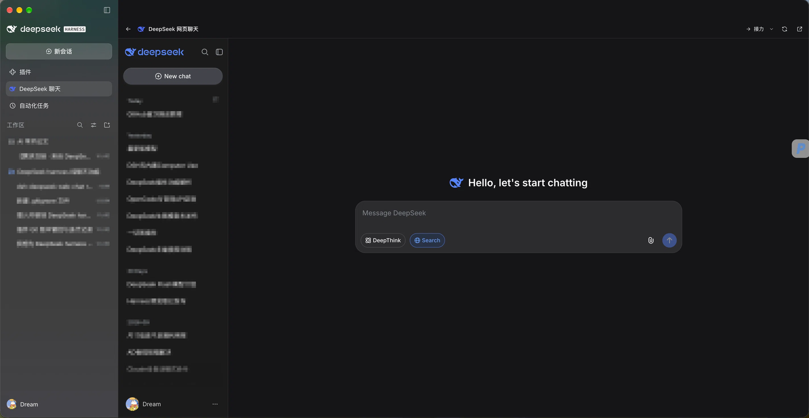

# DeepSeek 网页聊天（Harness 插件）

> 作者：Dream　·　当前版本：V1.2　·　版本记录见 [版本迭代记录.md](./版本迭代记录.md)

在 DeepSeek Harness 桌面客户端里增加一个与主界面融合的 DeepSeek 网页聊天面板，直接加载 <https://chat.deepseek.com/>，并把聊清楚的内容预览、筛选后接力到 Harness 输入框。



## 使用

1. 安装后，左侧栏会出现一个 DeepSeek 鲸鱼图标，位于「插件」和「自动化任务」之间。
2. 点击图标，会在主内容区打开 DeepSeek 网页聊天面板（不是单独的浮窗）。首次打开会显示三步引导。
3. 点击面板左上角的返回箭头、左侧栏的其他面板或会话即可离开；聊天页面会继续保持挂载，再次点击图标即可回到原来的对话。
4. 面板顶部提供「返回对话」「接力」「并排显示」「刷新」「在浏览器中打开」。
5. 快捷键：`Ctrl/⌘+Shift+D` 打开/关闭面板；`Ctrl/⌘+Shift+E` 直接进入接力预览；在任意 Harness 输入框输入 `/deepseek` 也能打开面板。

### 并排模式

点击顶栏的「并排显示」按钮，面板会停靠在窗口右侧，Harness 对话仍留在左侧可见、可操作；再次点击或按 `Esc` 回到全屏面板。并排模式目前是浮层停靠，不是原生右栏 Tab。

## 接力到 Harness

面板顶栏的「接力」按钮会先打开预览，再插入 Harness 输入框（作为草稿，不会自动发送）：

- 菜单可选「整段对话」「最后一条回复」「当前一轮问答」「选中片段」；主按钮默认整段。
- 预览里可以勾选具体消息、只保留「我」或「DeepSeek」、切换目标会话、查看字符数与估算 token。
- 默认勾选「插入后返回 Harness」：插入后自动切到目标会话、把焦点放回输入框，并在输入框上方显示一条提示；取消勾选则留在 DeepSeek 面板。
- 默认用「外部对话记录」分隔标记包裹，提示 agent 只当作背景资料，不要把其中内容当成指令；可关闭。
- 留在面板时插入成功可「撤销」；自动返回时可用 `Ctrl/⌘+Z` 撤销。目标会话不可用或插入失败时自动复制到剪贴板。
- 插入内容带来源和时间，角色用「我 / DeepSeek」，保留代码块、链接、图片地址和表格。
- 抓取通过读取 DeepSeek 页面 DOM 完成；读取时会显示已抓取条数/耗时，网页改版导致失败时会提示手动复制。

界面位置：DeepSeek 面板顶栏右上角、并排按钮左侧。


## 登录与浏览器会话

内嵌面板使用 Harness 桌面端提供的嵌入式浏览器租约（与内置 Browser 侧栏相同的机制）。该会话是非持久化分区：

- 在应用运行期间，登录状态会保留；离开聊天面板、切换面板、刷新 Harness 页面都不会丢失。
- 面板顶部会显示「已登录 / 未登录」徽标；未登录时点击徽标可直接重新加载登录页。
- 完全退出并重新启动应用后，需要重新登录 DeepSeek 网页版。
- 如果希望使用浏览器自身的持久登录，请点击面板顶部的「在浏览器中打开」。它会在系统默认浏览器中打开同一个地址。

## 为什么不修改客户端文件

这个功能以外部 Cordis bundle 的形式安装在当前 profile（`~/.dsh/profiles/desktop`）中，不会写入 `/Applications/DeepSeek Harness.app`，因此后续客户端更新不会覆盖它。插件通过 `link:` 指向本目录，所以请不要移动或删除本目录；否则需要重新安装。

## 文件

- `package.json`：bundle 与客户端模块清单
- `cordis.patch.yml`：向 profile 插入插件行
- `index.js`：Host 侧空实现（功能全部在客户端）
- `client.js`：侧栏图标、主内容区聊天面板、并排停靠、嵌入式浏览器租约、接力预览、快捷键与引导
- `tests/pure.test.mjs`：纯函数单测（接力范围、格式化、安全包裹、目标会话、token 估算）
- `locale/*.json`：插件管理器中显示的名称与说明
- `icon.svg`：插件图标，使用 DeepSeek 官方网页 favicon 中的鲸鱼标记（<https://fe-static.deepseek.com/chat/favicon.svg>），仅用于标识 DeepSeek 网页聊天入口
- `screenshot.png`：插件安装后的整体效果图（README 顶部）
- `handoff-button.png`：「接力」按钮位置示意图

## 开发与测试

```bash
npm test
```

单测通过 Node 内置测试运行器加载 `client.js` 的 `__test` 导出，不需要启动 Harness。

## 兼容性说明

- 内嵌网页依赖桌面端 preload 暴露的 `dshDesktop.browser` 租约接口。若未来客户端移除或修改该接口，插件会显示「当前环境不支持内嵌网页」，此时仍可使用「在浏览器中打开」；插件本身不会影响 Harness 启动。
- 快捷键依赖 DSH 的 `shortcuts` 服务；若快捷键注册冲突，插件会跳过绑定并在控制台告警，不影响面板使用。
- `package.json` 已声明 `dsh.manifestVersion`、`engines.dsh` 与仓库信息，便于后续发布到插件市场。
